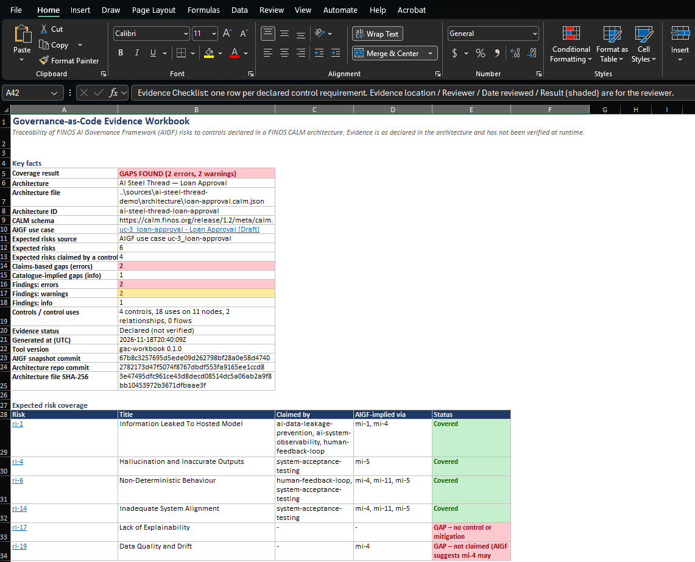
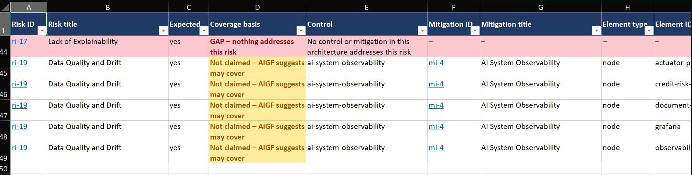
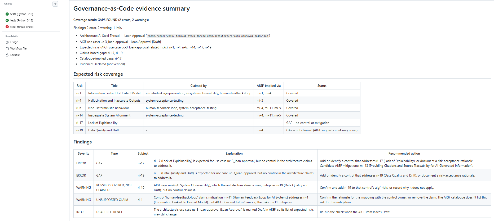

# Governance-as-Code Evidence Workbook

**Hackathon Track:** 2 – Extend & Utilize FINOS Governance-as-Code

[](https://github.com/jiaxingxue/gac-evidence-workbook/actions/workflows/governance-check.yml) Red is expected: the check finds 2 real AIGF coverage gaps (ri-17, ri-19) in the FINOS Steel Thread. See [Findings](#results-on-the-finos-steel-thread).

A CLI that reads a FINOS CALM architecture, traces its controls to FINOS AI Governance Framework (AIGF) risks and mitigations, flags uncovered risks and inconsistent claims, and exports an auditor-ready Excel evidence workbook. A CI check fails when gaps exist.

## Why

Auditors and second-line risk teams need to trace a path from **risk → control → evidence**. They work in Excel. Governance-as-Code expresses AI controls as JSON: CALM architectures whose controls declare AIGF mitigations and risks. When that information lives only in JSON spread across repositories, a reviewer can't easily answer three questions:

- Which risks does this AI system have to address?
- Which control claims to address each one, and where in the architecture is it?
- Does the AIGF catalogue agree with each claim?

This tool turns the JSON into a working paper a reviewer can read, filter, annotate and sign off.

## What it does

- **`gac-workbook check`** prints a coverage summary and findings, and exits non-zero when there are gaps (for CI).
- **`gac-workbook export`** writes `out/evidence-workbook.xlsx` and `out/summary.md`.

Workbook sheets:

| Sheet | Contents |
|---|---|
| **Summary** | Coverage result (`GAPS FOUND (n errors, n warnings)` / `NO GAPS FOUND`), AIGF use case, counts, expected-risk coverage table, generation time, tool version, source commit SHAs, architecture file SHA-256 |
| **Traceability** | One row per risk → control → mitigation → architecture element, with a coverage basis: *Claimed & AIGF-supported*, *Claimed – not in AIGF (unsupported)*, *Not claimed – AIGF suggests may cover* (risk has no supported claim), *Additional AIGF-suggested coverage (not claimed)* (risk is already covered; shown in light blue, not a finding), or *GAP – nothing addresses this risk* (with candidate AIGF mitigations) |
| **Findings** | Severity, type, risk, mitigation, control, element, plain-English explanation and recommended action, plus blank **Owner / Action / Due date / Status** columns for the reviewer |
| **Evidence Checklist** | One row per declared control requirement: the evidence the architecture declares, plus blank **Evidence location / Reviewer / Date reviewed / Result** (Pass / Fail / N/A) |
| **Sources** | Repositories, commits, licenses and the AIGF CC-BY-4.0 attribution |

Finding types:

| Finding | Severity | Meaning | Recommended action |
|---|---|---|---|
| GAP | error | An expected risk is not claimed by any control | Add or identify a control that addresses the risk, or document a risk-acceptance rationale (candidate AIGF mitigations are listed when nothing in the architecture covers the risk) |
| UNKNOWN ID | error | An ID isn't in the AIGF snapshot | Correct the ID or update the AIGF snapshot |
| UNSUPPORTED CLAIM | warning | A control claims mitigation *m* addresses risk *r*, but AIGF's *m* doesn't list *r* | Confirm the rationale with the control owner, or remove the claim |
| POSSIBLY COVERED, NOT CLAIMED | warning | AIGF says a mitigation the architecture uses covers an expected risk, but no control claims it | Confirm and add the risk to that control's `aigf-risks`, or record why it doesn't apply |
| DRAFT REFERENCE | info | The use case, or an item a control references, is Draft in AIGF | Re-run the check when the AIGF item leaves Draft |

## Quick start

Commands are for Git Bash on Windows, or bash on Linux and macOS. Requires Python 3.10+ and Git. Use `python3` if `python` isn't on your path.

**1. Create a virtual environment and install**

```bash
git clone https://github.com/jiaxingxue/gac-evidence-workbook.git
cd gac-evidence-workbook
python -m venv .venv
source .venv/Scripts/activate   # Linux/macOS: source .venv/bin/activate
pip install -e .
```

**2. Clone the Steel Thread into `../sources` at the pinned commit**

```bash
git clone https://github.com/finos-hack/ai-steel-thread-demo.git ../sources/ai-steel-thread-demo
git -C ../sources/ai-steel-thread-demo checkout 2782173d47f5074f8767dbdf553fa9165ee1ccd8
```

**3. Run the check and export the workbook**

```bash
gac-workbook check --arch ../sources/ai-steel-thread-demo/architecture/loan-approval.calm.json
gac-workbook export --arch ../sources/ai-steel-thread-demo/architecture/loan-approval.calm.json --out out/evidence-workbook.xlsx
```

`check` exits with code 1 here because it finds real gaps. `export` writes `out/evidence-workbook.xlsx` and `out/summary.md`.

Options:

| Option | Commands | Purpose |
|---|---|---|
| `--aigf PATH` | check, export | AIGF snapshot (default: `data/aigf-snapshot.json`) |
| `--expected-risks ri-1,ri-4` | check, export | Override the expected risks (for architectures that name no AIGF use case) |
| `--format text\|json` | check | Output format |
| `--fail-on error\|warning\|none` | check | When to exit 1: on errors (default), on errors or warnings, or never |
| `--out PATH`, `--summary PATH` | export | Output paths |

Exit codes for `check`: `0` pass, `1` findings at or above `--fail-on`, `2` input error.

## How coverage is assessed

1. **Expected risks** come from the AIGF use case named in the architecture metadata (`finos-use-case`), specifically its `related_risks`. For the Steel Thread this is `uc-3_loan-approval`: ri-1, ri-4, ri-6, ri-14, ri-17, ri-19. `--expected-risks` overrides this.
2. **Claimed coverage** is the risks each control lists in its own `aigf-risks`. There is no separate hand-written mapping.
3. **Catalogue-implied coverage** is the risks in AIGF's `mitigates` list for each mitigation that controls name in `aigf-mitigations`.
4. **"Any mitigation in the control" rule:** a claim that a control addresses risk *r* is *supported* when **any** mitigation in that control's `aigf-mitigations` lists *r* in AIGF. Otherwise it is an UNSUPPORTED CLAIM (warning).
5. **Covered:** an expected risk is *Covered* when at least one control claims it and at least one claim is supported. In the Steel Thread, ri-1 is claimed by three controls: the mi-11 claim is unsupported, but the mi-1 and mi-4 claims are supported, so ri-1 is Covered and the mi-11 claim still gets its own warning.
6. **Gaps:** an expected risk that no control claims is a GAP (error). If a mitigation the architecture already uses covers it in AIGF, it is also reported as POSSIBLY COVERED, NOT CLAIMED (warning), so ri-19 deliberately appears in both views.
7. **Severities and `--fail-on`:** errors are GAP and UNKNOWN ID; warnings are UNSUPPORTED CLAIM and POSSIBLY COVERED, NOT CLAIMED; info is DRAFT REFERENCE. By default `check` fails on errors only. `--fail-on warning` is stricter and `--fail-on none` only reports.
8. **Evidence** is labelled *Declared (not verified)*: the control's `requirement-url` and inline `config` from CALM. Runtime evidence is not checked.

Design decisions are recorded in [docs/decisions.md](docs/decisions.md), and data provenance in [docs/data-sources.md](docs/data-sources.md).

## Results on the FINOS Steel Thread

`gac-workbook check` on [finos-hack/ai-steel-thread-demo](https://github.com/finos-hack/ai-steel-thread-demo) @ `2782173` against AIGF @ `67b8c32` (abridged; recommended-action lines omitted):

```text
Use case      : uc-3_loan-approval - Loan Approval [Draft]
Expected risks: ri-1, ri-4, ri-6, ri-14, ri-17, ri-19  [6, from AIGF use case uc-3_loan-approval related_risks]
Controls      : 4 distinct, 18 uses on 11 nodes, 2 relationships, 0 flows

RISK   TITLE                                 AIGF-IMPLIED VIA   STATUS
ri-1   Information Leaked To Hosted Model    mi-1, mi-4         Covered
ri-4   Hallucination and Inaccurate Outputs  mi-5               Covered
ri-6   Non-Deterministic Behaviour           mi-4, mi-11, mi-5  Covered
ri-14  Inadequate System Alignment           mi-4, mi-11, mi-5  Covered
ri-17  Lack of Explainability                -                  GAP – no control or mitigation
ri-19  Data Quality and Drift                mi-4               GAP – not claimed (AIGF suggests mi-4 may cover)

Findings (2 error, 2 warning, 1 info)
Coverage result: GAPS FOUND (2 errors, 2 warnings)
Exit policy    : --fail-on error -> exit 1
```

| Severity | Finding | Subject | What it means |
|---|---|---|---|
| ERROR | GAP | ri-17 Lack of Explainability | UC-3 expects it; no control claims it and no mitigation in use covers it. The AIGF candidate is mi-13 (Providing Citations and Source Traceability for AI-Generated Information). |
| ERROR | GAP | ri-19 Data Quality and Drift | UC-3 expects it; no control claims it. |
| WARNING | POSSIBLY COVERED, NOT CLAIMED | ri-19 via mi-4 | AIGF says mi-4 (AI System Observability), already used by `ai-system-observability`, mitigates ri-19. |
| WARNING | UNSUPPORTED CLAIM | mi-11 → ri-1 | `human-feedback-loop` claims mi-11 addresses ri-1; AIGF's mi-11 doesn't list ri-1. |
| INFO | DRAFT REFERENCE | uc-3 | The UC-3 Loan Approval use case is Draft in AIGF, so the expected-risk list may change. |

## Screenshots

**1. Summary sheet:** coverage result, key facts and expected-risk coverage for the FINOS Steel Thread.


**2. Traceability sheet:** ri-17 has no control or mitigation (red); ri-19 is not claimed, though AIGF suggests mi-4 may cover it (amber).


**3. GitHub Actions job summary:** the CI run shows the same result, findings and recommended actions; the red check is expected.


## Continuous integration

The [governance-check](.github/workflows/governance-check.yml) workflow runs on push, pull request and manual dispatch, on `ubuntu-24.04`:

- **tests:** runs pytest on Python 3.10 and 3.13 using only the synthetic fixtures in [tests/fixtures/](tests/fixtures/). Tests that need the Steel Thread or AIGF clones are skipped.
- **steel-thread-check:**
  1. Verifies that the pinned Steel Thread SHA matches [docs/data-sources.md](docs/data-sources.md).
  2. Clones the Steel Thread at that commit, outside the workspace (it is never committed).
  3. Runs `calm validate` (`@finos/calm-cli` 1.73.0).
  4. Runs `gac-workbook export`, then `gac-workbook check`.
  5. Adds `summary.md` to the job page and uploads the workbook as the `evidence-workbook` artifact (kept 7 days). These two steps run even when the check fails.

**A red `steel-thread-check` is expected.** It shows the tool working: it found real coverage gaps (ri-17, ri-19) in the Steel Thread architecture. The job turns green when those gaps are addressed upstream, or when they are accepted through a waiver file (see Roadmap).

## Validation status

| Check | Result |
|---|---|
| `pytest` (local, Python 3.14.7) | 52 passed |
| `pytest` (local, Python 3.10.8) | 52 passed |
| `pytest` in CI (`tests` job, Python 3.10 and 3.13) | Passed (commit `d966a25`); Steel Thread / AIGF clone tests skipped by design |
| `calm validate` on the Steel Thread @ `2782173` (`@finos/calm-cli` 1.73.0) | 0 errors, 0 warnings, locally ([baseline](docs/calm-validate-baseline.txt)) and in CI |
| `gac-workbook check` on the Steel Thread | GAPS FOUND (2 errors, 2 warnings), exit 1, as expected |
| AIGF catalogue URLs (risk, mitigation, use-case patterns) | HTTP 200 (checked 2026-11-18) |

## Development

```bash
pip install -e ".[dev]"
pytest -rs
```

Regenerate the AIGF snapshot from a clean clone at the pinned commit (see [data/README.md](data/README.md)):

```bash
git clone https://github.com/finos/ai-governance-framework.git ../sources/ai-governance-framework
git -C ../sources/ai-governance-framework checkout 67b8c3257695d5ede09d262798bf28a0e58d4740
python scripts/build_aigf_snapshot.py ../sources/ai-governance-framework \
  --expect-commit 67b8c3257695d5ede09d262798bf28a0e58d4740
```

Layout: `src/gac_workbook/` (`calm.py` loader, `aigf.py` snapshot, `coverage.py` engine, `workbook.py` Excel and Markdown, `cli.py`), `scripts/` (snapshot generator), `data/` (AIGF snapshot), `tests/` (pytest and synthetic fixtures).

## Roadmap

1. Risk-acceptance / waiver file so accepted risks don't fail CI.
2. Verify runtime evidence from the Steel Thread's metrics and tests, instead of declared evidence only.
3. Common Cloud Controls coverage via `catalogs/ai-ml/gen-ai/mappings/threats-finos-aigf.yaml`.
4. CALM Hub integration: read architectures from, and publish results to, CALM Hub.
5. An xlsx output option for `calm docify`, offered upstream.
6. A GitHub Pages viewer for the workbook and findings.

## What this is not

- **Not a compliance certification.** It checks consistency between declared controls and the AIGF catalogue.
- **Evidence is declared, not verified.** The workbook records what the architecture declares; a reviewer must confirm it.
- **Findings need expert review.** An unsupported claim may be a reasonable mapping that AIGF doesn't list, and a gap may be an accepted risk.
- **UC-3 is Draft in AIGF.** The expected-risk list for the Steel Thread can change when the use case is finalised.

## How this was built

I (Jiaxing Xue) directed [Claude Code](https://claude.com/claude-code) and reviewed every change during the hackathon. Commits carry a `Co-Authored-By: Claude` trailer alongside my DCO `Signed-off-by`.

## Licensing

- **This project's code:** Apache-2.0 (see [LICENSE](LICENSE)).
- **AIGF snapshot** ([data/aigf-snapshot.json](data/aigf-snapshot.json)): IDs, titles, status, links and catalogue URLs from the [FINOS AI Governance Framework](https://github.com/finos/ai-governance-framework) @ `67b8c32`, © FINOS, [CC-BY-4.0](https://creativecommons.org/licenses/by/4.0/). No body text is copied. Attribution is in [NOTICE](NOTICE) and [data/README.md](data/README.md).
- **Steel Thread:** read, not copied. The repository declares no license, so none of its files are in this repo. Tests use our own synthetic fixtures, and CI clones it at a pinned commit. A license request is drafted in [docs/upstream-issue-license.md](docs/upstream-issue-license.md). Generated workbooks contain excerpts of its control declarations, so CI artifacts are kept for 7 days only.

## Contributing

Coding agents should follow [AGENTS.md](./AGENTS.md), which requires a Developer Certificate of Origin sign-off on every commit.

**All commits** must be signed with a DCO signature to avoid being flagged by the DCO Bot. This means that your commit log message must contain a line that looks like the following one, with your actual name and email address:

```
Signed-off-by: John Doe <john.doe@example.com>
```

See [CONTRIBUTING.md](./CONTRIBUTING.md) for more information.

## License

Copyright 2026 Jiaxing Xue

Distributed under the [Apache License, Version 2.0](http://www.apache.org/licenses/LICENSE-2.0).

SPDX-License-Identifier: [Apache-2.0](https://spdx.org/licenses/Apache-2.0)
